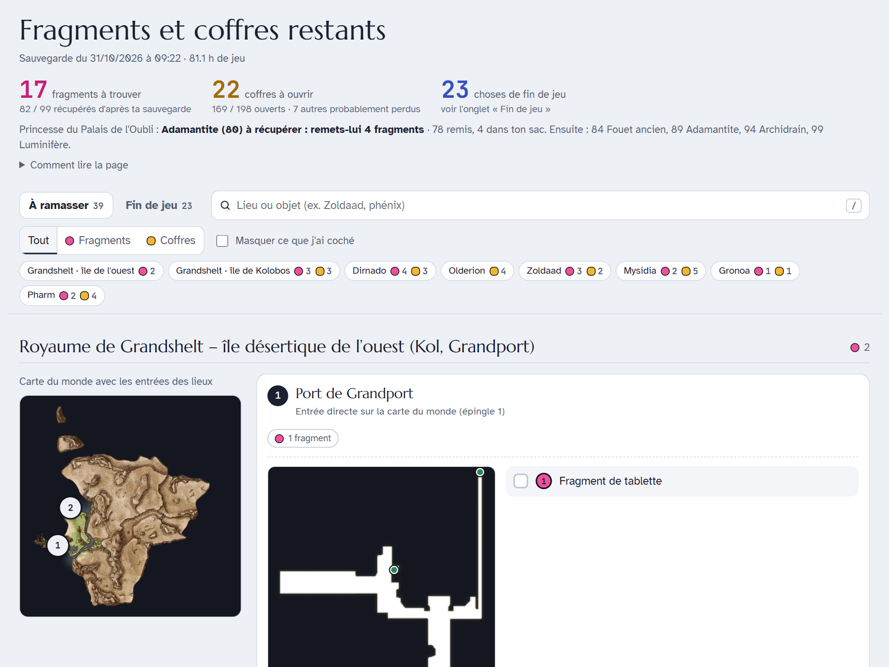
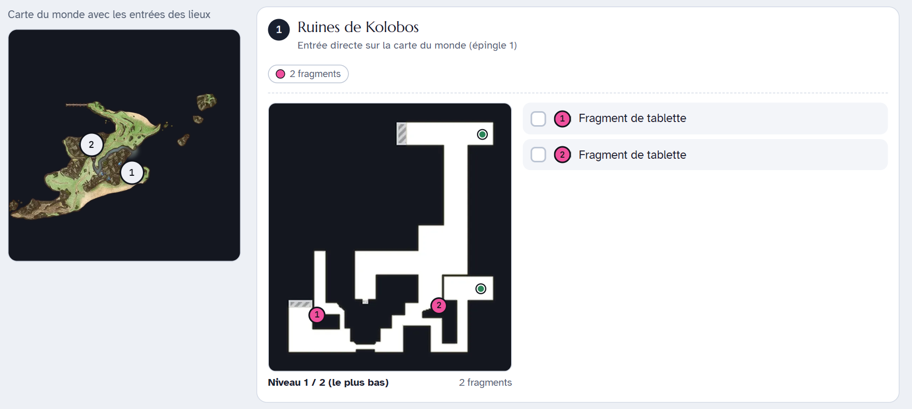
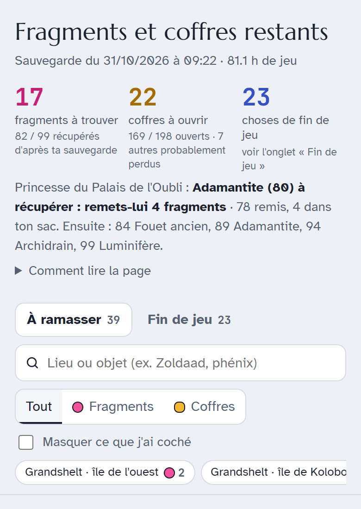
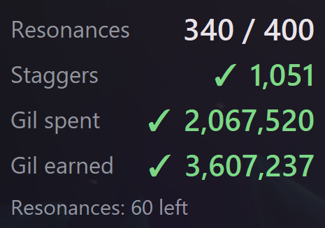
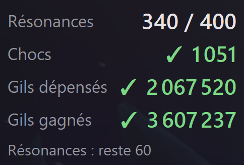

<div align="center">

# FF Resonance Atlas

**Missing tablet shards, missing chests and a live achievement counter for FINAL FANTASY RESONANCE**

[](LICENSE)
[](https://www.python.org/)
[](#requirements)
[](#set-it-up-with-an-ai-agent)
[-0a7ea4)](#safety)

<picture>
  <source media="(prefers-color-scheme: dark)" srcset="docs/img/atlas-dark.png">
  
</picture>

[Project page](https://ff-resonance-atlas.zqsdev.com) ·
[Set it up with an AI agent](#set-it-up-with-an-ai-agent) ·
[Quick start](#quick-start) ·
[Atlas](#atlas-of-missing-tablet-shards-and-chests) ·
[Achievement counter](#live-achievement-counter) ·
[Safety](#safety) ·
[En français](#en-français)

</div>

Free, open-source **100% completion helper for FINAL FANTASY RESONANCE** (FF Resonance, FFRS) on
Steam / PC and Steam Deck. It reads **your own game files and your own save** and shows only what you
still have to do:

<table>
<tr>
<td width="50%" valign="top">

### 🗺️ Atlas

Every **Tablet Shard** (*Fragment de tablette*, 99 in total) and **treasure chest** you have not picked
up yet, island by island, on the game's own map plans with numbered markers.

</td>
<td width="50%" valign="top">

### 🔢 Live counter

Your **Resonances** for *Resonance Rapid Fire* (400), **staggers** for *Keep Them on Their Toes*
(1000) and gil for the two gil achievements, updated every second while you play.

</td>
</tr>
</table>

## Set it up with an AI agent

The repository is ready for coding agents and MCP clients. Paste this to your agent:

> Set up https://github.com/Aleqsd/ff-resonance-atlas for me: clone it, follow its AGENTS.md, then open
> my atlas of missing tablet shards and chests for FINAL FANTASY RESONANCE.

[`AGENTS.md`](AGENTS.md) tells the agent how to install everything with one command, what it must never
touch (game, Steam and save folders) and how to answer questions such as *"where is my next missing
shard?"* or *"how many Resonances do I have left?"*.

**MCP server.** `mcp_server.py` lets any MCP client ask those questions directly:

| Tool | What it returns |
|---|---|
| `setup_status` | what is ready (game, saves, tools, extracted data, atlas) and the exact next step |
| `refresh_atlas` | rebuilds the atlas and the missing list from the newest save |
| `missing_items` | missing shards and chests, filtered by kind or island, with how to reach each place |
| `achievement_counters` | Resonances, staggers and gil vs the achievement goals, live or from the save |

```
pip install -r requirements-mcp.txt
```

Then add the server to your client's MCP configuration (most clients use this shape):

```json
{
  "mcpServers": {
    "ff-resonance-atlas": {
      "command": "python",
      "args": ["C:/path/to/ff-resonance-atlas/mcp_server.py"]
    }
  }
}
```

Clients that read a project-level `.mcp.json` pick it up automatically when opened in the repository.

## Quick start

```
git clone https://github.com/Aleqsd/ff-resonance-atlas
cd ff-resonance-atlas
python bootstrap.py
```

`bootstrap.py` checks your setup, installs the Python packages, builds the two small helper tools, extracts
the game data it needs (a few minutes the first time) and builds `work/atlas.html`. Run
`python bootstrap.py --check` to see what is ready without changing anything. After each play session:

```
python atlas.py        # refresh work/atlas.html and work/missing.json from your newest save
pythonw counter.py     # live achievement counter (Windows)
```

## Atlas of missing tablet shards and chests

<picture>
  <source media="(prefers-color-scheme: dark)" srcset="docs/img/plan-dark.png">
  
</picture>



`atlas.py` builds a single offline HTML page (`work/atlas.html`) that lists **only what you are still
missing**:

- **Tablet shards** (*Fragments de tablette*) and **treasure chests** not yet picked up,
- grouped island by island, place by place, on the game's own **map plans** with numbered markers,
- a world map per island with a pin for every place that still has something,
- tick boxes to cross items off while you play (stored in your browser only),
- the shard-collector rewards still ahead of you,
- an optional "late game" to-do tab (see below),
- light and dark themes, and a layout that works on a phone next to your screen.

It also writes `work/missing.json`, the same list without images, for scripts and AI agents.

The newest save slot is picked automatically. The page is in **French** (place and item names come from
the game's official French text).

> **Spoilers:** the page names places and items from the whole game, including areas you have not
> reached yet.

<br clear="right">

## Live achievement counter



`counter.py` shows your progress on the four count-based achievements:

| Achievement | French name | Goal |
|---|---|---|
| Resonance Rapid Fire | Adepte des résonances | Use Resonances 400 times |
| Keep Them on Their Toes | Quel choc ! | Stagger enemies 1000 times |
| Gil Comes and Goes | Ça s'en va et ça revient | Spend 100,000 gil |
| Making Lid Proud | Rendre Lid fière | Gain 1,000,000 gil |

<br clear="right">

```
pythonw counter.py           # small always-on-top window, live while you play (Windows)
python counter.py --once     # print the live values once in the console (Windows)
python counter.py --save     # values stored in your newest save (Windows, Linux, Steam Deck)
```

- **Live mode** (Windows) needs only Python 3.10+ and `numpy`: no game data extraction, no Rust tools.
  Start it while the game is running (or before: it waits for the game). It finds the game's player
  statistics in about 2 seconds, then refreshes every second. The game must be in windowed or
  borderless mode for the window to show on top. Drag it with the left mouse button; right-click for
  *Search again* / *Close*. A Windows sound plays when a goal is reached.
- **Save mode** reads the newest `GameSaveData*.sav` the same way as the atlas (needs the setup above,
  or `FFRS_SAVE_KEY`). It only changes when the game saves.
- Labels follow your Windows display language (English or French); force one with `--lang en` or
  `--lang fr`.
- The values come from the game's own statistics block (`SaveData_Player`: `finishblowCount`,
  `breakCount`, `spentMoney`, `earnedMoney`). Resonances are called *finish blows* inside the game.
- Task Manager may show the game's memory use go up after the first search: those are pages of the
  game being read once, nothing is allocated in the game.

## Safety

- **Read-only.** Game files and saves are only opened for reading. Each save is first copied into the
  work folder, and only that copy is decrypted and parsed (then deleted). Nothing is ever written to the
  game folder, the Steam folder or the save folder.
- No mod, no injection, and the game is never launched. Steam achievements and cloud saves are not
  affected.
- The atlas never touches the running game. Only the live counter looks at it, and only by **reading**
  its memory: the process is opened with "read memory" and "query information" rights only, so it
  cannot write, inject code or create threads in the game. It does not stop the game from unlocking
  achievements.
- Everything happens locally. Nothing is uploaded. (The atlas page only fetches web fonts from
  Google Fonts when you open it; without a connection it falls back to system fonts.)

## Requirements

- **Windows**, or **Linux / Steam Deck** running the game through Proton (the Proton prefix
  `steamapps/compatdata/3259780/pfx/...` is searched automatically). On Linux use `python3`.
- **Python 3.10+**. `bootstrap.py` installs the packages in `requirements.txt`.
- A **Rust toolchain** (https://rustup.rs, Rust 1.85 or newer; on Windows `winget install
  Rustlang.Rustup`) to build the two small helper programs once. `ooz_cli` decompresses the game's
  Oodle-compressed data blocks, `texdec` decodes BCn textures (map plans) to PNG. Both only read their
  input.
- A few hundred MB of free disk space for `work/` (plus the Rust build folders).

<details>
<summary><b>Manual setup, paths and environment variables</b></summary>

```
pip install -r requirements.txt
cd tools/ooz_cli && cargo build --release && cd ../..
cd tools/texdec  && cargo build --release && cd ../..
python extract_gamedata.py     # once (use --force after a game update)
python atlas.py                # after each play session -> work/atlas.html
```

`extract_gamedata.py` skips steps whose output already exists; after a game update run it with
`--force` so everything is extracted again. Open `work/atlas.html` in any browser (desktop or phone).

Everything is auto-detected (Steam libraries through `libraryfolders.vdf`, saves in
`%LOCALAPPDATA%\FFRS` or the Proton prefix). If detection fails, set these environment variables:

| Variable | Meaning |
|---|---|
| `FFRS_GAME_DIR` | the `FINAL FANTASY RESONANCE` install folder (the one containing `FFRS/Content/Paks`) |
| `FFRS_SAVE_DIR` | a folder containing `GameSaveData*.sav` (searched recursively) |
| `FFRS_WORK` | where extracted data and the page are written (default `./work`) |
| `FFRS_OOZ`, `FFRS_TEXDEC` | paths to the two helper programs (default `tools/*/target/release/`) |
| `FFRS_SAVE_KEY` | optional: the save encryption key, if it cannot be read from the game install |

Flatpak Steam on Linux is not searched by default: point `FFRS_GAME_DIR` and `FFRS_SAVE_DIR` to the
paths under `~/.var/app/com.valvesoftware.Steam/`. On Windows, if the Rust build fails because of a
too long path, clone the repository to a short folder such as `C:\ffrs`.

The atlas page embeds map images decoded from your copy of the game. Keep it for your own use;
please do not redistribute it.

</details>

<details>
<summary><b>How it works</b></summary>

1. **IoStore / Zen reader** (`utoc.py`, `zen.py`, `extract.py`): reads the `.utoc` / `.ucas` container
   index, decompresses blocks with `ooz_cli` and parses Unreal Engine 5.6 Zen packages. Classic `.pak`
   files (config, localisation) are read by `pakfile.py` / `paklist.py`.
2. **Reflection dump** (`refl.py`, `peutil.py`): the game cooks its assets with *unversioned
   properties*, so the property layout of each class is not stored in the assets. It is recovered from
   the reflection data compiled into the game executable.
3. **Tables and text** (`dt.py`): treasure tables, item tables, map tables and the French/English
   localisation (`.locres`).
4. **Level scans** (`scan_levels.py`, `scan_areas.py`, `scan_entr.py`): every level is scanned for
   treasure boxes and field items (with their unique IDs and world positions), map capture areas (the
   plans shown in the in-game map menu) and entrances between maps.
5. **Map plans** (`tex.py` + `texdec`): the game's own plan textures are decoded locally and embedded.
6. **Save**: the newest `GameSaveData*.sav` is copied, decrypted with the AES key that the game itself
   ships in its config file `DefaultSQEXSaveGameSystem.ini` (read at run time from your install by
   `savekey.py`; the key is not part of this repository), then parsed as GVAS (`gvas.py`).
7. **Cross-reference** (`build_data.py`, `build_page.py`): opened chests, picked-up items, inventory,
   shards already handed in and story progress are matched against the scanned level data; what is
   left is grouped by island, place and plan, and injected into `template.html`.
8. **Live counter** (`counter.py`): finds the game's `SaveData_Player` statistics block in the running
   process by its layout (taken from the reflection data) and reads it every second.

`curated/` holds small hand-made mappings for the tested game build: readable French place labels,
floor labels, how to reach each place, streamed sub-levels per map, and a few manual fixes
(`overrides.json`).

</details>

<details>
<summary><b>Optional late-game to-do tab</b></summary>

If `work/late_todo.json` exists, a second tab "Fin de jeu" shows it as a tickable list. Format:

```json
{
  "intro": "Short state line. Déjà terminé : ... Ordre conseillé : 1) first step ; 2) second step",
  "categories": [
    {
      "name": "Quêtes",
      "items": [
        { "title": "Quest name", "where": "Place name", "detail": "Notes", "status": "à faire", "priority": "haute" }
      ]
    }
  ],
  "caveats": "Optional closing note."
}
```

All fields except `categories[].name` and `items[].title` are optional. `priority` values `haute` and
`moyenne` are highlighted. When `where` matches place names in the atlas, a "Voir sur l'atlas" link is
added. In `intro`, the optional markers `Déjà terminé :` and `Ordre conseillé :` (followed by
`1) ... ; 2) ...`) are rendered as a collapsed "already done" note and a numbered list.

</details>

## Limits

- Tested with the Steam build of FINAL FANTASY RESONANCE current as of **October 2026** (Unreal
  Engine 5.6). A game update can change packages or class layouts; re-run `extract_gamedata.py
  --force`, and if parsing fails the scripts (or `curated/`) may need an update.
- Some rooms are missing from the game's own map plans: those items get a **dashed marker at an
  estimated position**.
- Chests that only existed in prologue or past-story versions of a map are **probably no longer
  obtainable**; they are listed separately in a collapsed section instead of being counted as missing.
- The atlas UI and place names are French only (the counter is in English or French).

## Licenses and disclaimer

The code in this repository is released under the **MIT License** (see `LICENSE`).

The two Rust helpers depend only on permissively licensed crates: `oozextract` (MIT),
`texture2ddecoder` (MIT OR Apache-2.0; its BCn decoder is derived from MIT-licensed code), `png`
(MIT OR Apache-2.0) and their dependencies (MIT, Apache-2.0, Zlib, Unlicense, 0BSD, Unicode-3.0;
see `tools/*/Cargo.lock`). No third-party source is vendored here. If you redistribute compiled
binaries, include those crates' license notices.

This is an **unofficial fan tool**. It is not affiliated with, endorsed, sponsored or approved by
SQUARE ENIX. **No game files or game text are included** in this repository, apart from a few short
place names in the curated mapping files and the screenshots in `docs/img/`, which show the tool's
output (including excerpts of the game's map plans) for illustration. Everything else is extracted
locally from your own copy of the game. FINAL FANTASY and FINAL FANTASY RESONANCE are trademarks or
registered trademarks of Square Enix Holdings Co., Ltd. Use at your own risk.

## En français



Aide pour finir **FINAL FANTASY RESONANCE à 100 %** (FF Resonance, Steam / PC et Steam Deck).

**Avec un agent IA** : donne-lui simplement cette consigne :

> Installe https://github.com/Aleqsd/ff-resonance-atlas en suivant son AGENTS.md, puis ouvre mon atlas
> des fragments de tablette et des coffres manquants de FINAL FANTASY RESONANCE.

**À la main** : `git clone https://github.com/Aleqsd/ff-resonance-atlas`, puis `python bootstrap.py`
dans le dossier. Après chaque session de jeu : `python atlas.py`.

**Atlas** : une page HTML hors ligne (`work/atlas.html`) avec les **Fragments de tablette manquants**
(99 au total) et les **coffres manquants**, île par île, sur les plans de carte du jeu avec des repères
numérotés. La sauvegarde la plus récente est choisie automatiquement. Attention : la page contient des
noms de lieux de tout le jeu (spoilers).

**Compteur de hauts faits en direct** : `pythonw counter.py` affiche une petite fenêtre toujours au
premier plan, mise à jour chaque seconde pendant que tu joues :

- **Résonances** pour le haut fait *Adepte des résonances* (400),
- **Chocs** pour *Quel choc !* (1000),
- **Gils dépensés** pour *Ça s'en va et ça revient* (100 000) et **gils gagnés** pour *Rendre Lid
  fière* (1 000 000).

Le compteur en direct ne demande que Python et `numpy` (Windows). `python counter.py --save` donne les
mêmes chiffres depuis ta dernière sauvegarde, y compris sur Linux et Steam Deck.

- **Lecture seule** : les fichiers du jeu et les sauvegardes ne sont jamais modifiés (la sauvegarde est
  copiée puis lue), aucun mod, le jeu n'est pas lancé, les hauts faits Steam ne sont pas concernés. Le
  compteur ne fait que **lire** la mémoire du jeu : il n'écrit rien et n'injecte rien.
- **Prérequis** : Python 3.10+ et Rust (https://rustup.rs) pour l'atlas ; `bootstrap.py` s'occupe du
  reste.
- Outil de fan non officiel, sans lien avec SQUARE ENIX. Aucun fichier ni texte du jeu n'est fourni :
  tout est extrait localement depuis ta propre copie du jeu.
