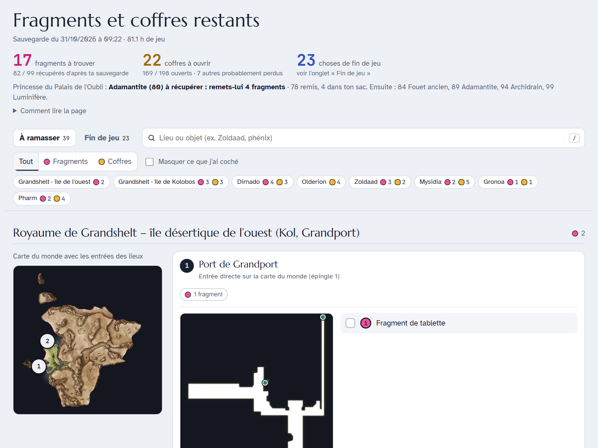
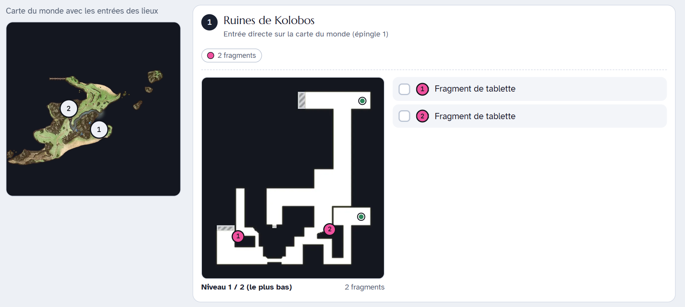
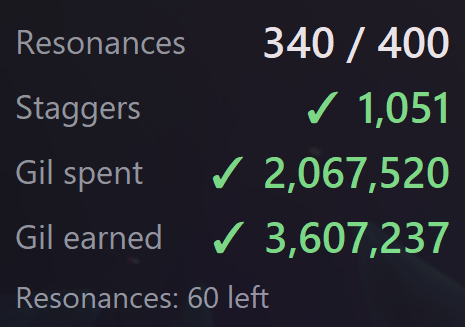

**FF Resonance Atlas** is a free, open-source helper for finishing **FINAL FANTASY RESONANCE at 100%**
(Steam / PC and Steam Deck). It reads your own game files and your own save, read-only, and shows only
what you still have to do.

**[Download and instructions on GitHub](https://github.com/Aleqsd/ff-resonance-atlas)**

## Set it up with an AI agent

Paste this to your coding agent:

> Set up https://github.com/Aleqsd/ff-resonance-atlas for me: clone it, follow its AGENTS.md, then open
> my atlas of missing tablet shards and chests for FINAL FANTASY RESONANCE.

The repository has an `AGENTS.md` with the setup steps and safety rules, a one-command installer
(`python bootstrap.py`) and an **MCP server** (`mcp_server.py`) so any MCP client can list your missing
shards and chests or read your achievement counters.

## Where are my missing tablet shards and chests?

The atlas (`atlas.py`) builds an offline page listing the **Tablet Shards** (*Fragments de tablette*,
99 in total) and the **treasure chests** you have not picked up yet, island by island, on the game's own
map plans with numbered markers. It always uses your newest save slot, and you can tick items off while
you play.

## How many Resonances have I used?

The live counter (`counter.py`) is a small always-on-top window that updates every second while you play:

| Achievement | Goal |
|---|---|
| Resonance Rapid Fire (*Adepte des résonances*) | Use Resonances 400 times |
| Keep Them on Their Toes (*Quel choc !*) | Stagger enemies 1000 times |
| Gil Comes and Goes (*Ça s'en va et ça revient*) | Spend a total of 100,000 gil |
| Making Lid Proud (*Rendre Lid fière*) | Gain a total of 1,000,000 gil |

On Windows it only needs Python and `numpy`. On Linux and Steam Deck, `counter.py --save` gives the same
numbers from your newest save.

## Is it safe for my save and Steam achievements?

Yes. Saves are copied before being read and are never written. There is no mod and no injection. The
live counter only **reads** the game's memory: it cannot change anything in the game, and achievements
unlock normally.

## En français

Outil gratuit pour finir **FINAL FANTASY RESONANCE à 100 %** : la carte des **Fragments de tablette
manquants** et des **coffres manquants** d'après ta propre sauvegarde, et un **compteur de résonances**
en direct pour le haut fait *Adepte des résonances* (400), plus les chocs (*Quel choc !*, 1000) et les
gils. Lecture seule : ta sauvegarde et tes hauts faits Steam ne sont pas touchés.
[Téléchargement et mode d'emploi sur GitHub](https://github.com/Aleqsd/ff-resonance-atlas#en-français).

---

Unofficial fan tool, not affiliated with SQUARE ENIX. FINAL FANTASY is a registered trademark of Square
Enix Holdings Co., Ltd.
